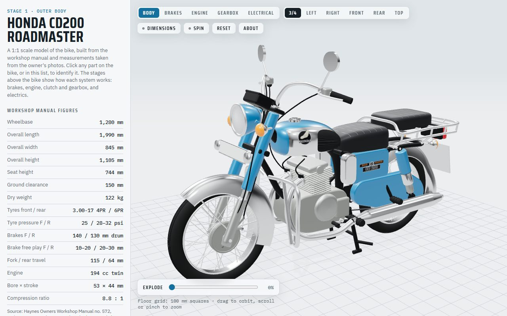
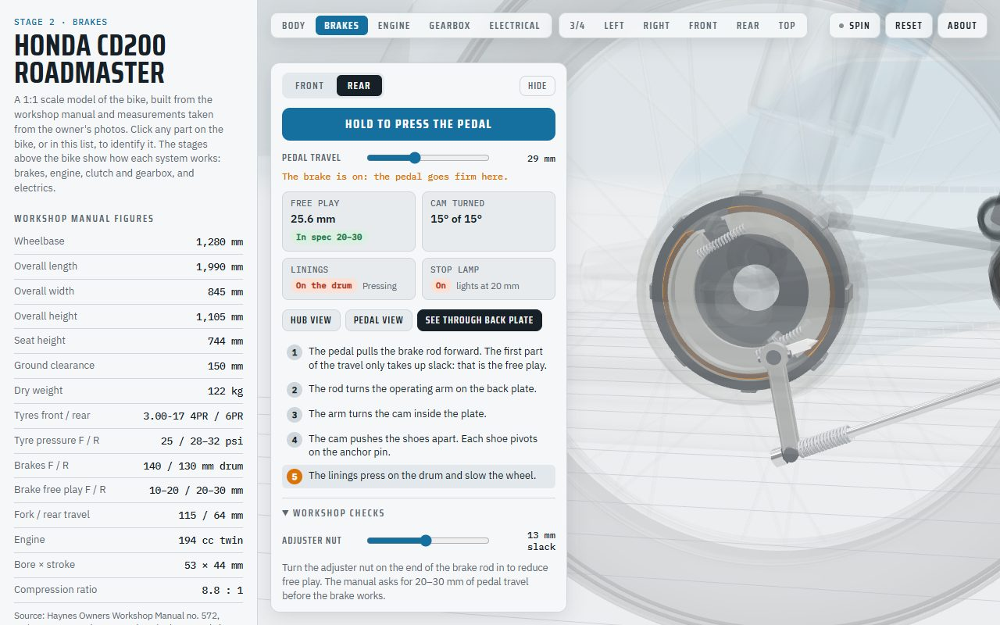
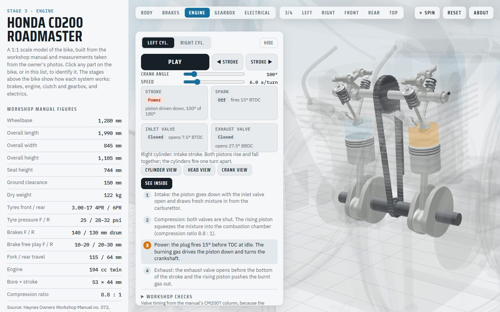
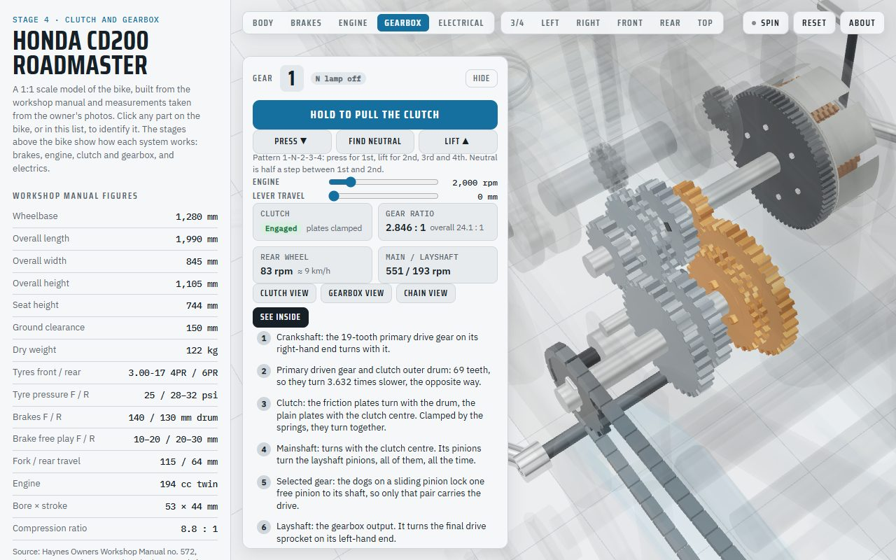
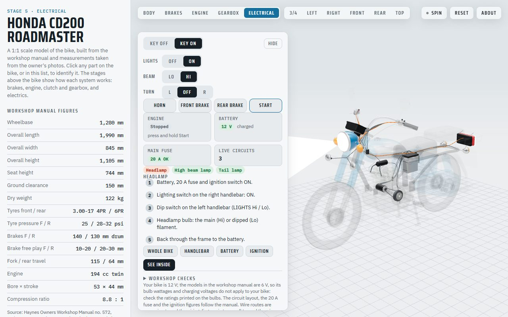

# Honda CD200 Roadmaster in 3D

An interactive, full-scale 3D model of my own Honda CD200 Roadmaster, built one system at a time
so you can see how a classic motorcycle works: operate the brakes, watch the engine's four-stroke
cycle, shift through the gearbox and follow the current round the wiring.

**Live:** https://aravinda89.github.io/honda-cd200-roadmaster-3d/



## What you can do

The page has five stages, chosen from the buttons above the bike.

| | Stage | What it shows |
|---|---|---|
| 1 | **Outer body** | Rotate and zoom the bike, click any part to see what it is and what it does, explode the assembly, and compare the model with the published dimensions. |
| 2 | **Drum brakes** | Squeeze the lever or press the pedal and watch the cable or rod turn the cam, the shoes swing out on the anchor pin and the linings meet the drum. Set the free play with the adjuster nut, wear the linings to the 2.0 mm service limit and watch the wear indicator. |
| 3 | **Engine** | The four-stroke cycle in this 194 cc parallel twin: both pistons rise and fall together and fire one turn apart. Step stroke by stroke, follow either cylinder, and set the engine to TDC on compression for a valve clearance check. |
| 4 | **Clutch and gearbox** | Pull the clutch and watch the plates part, shift 1-N-2-3-4, and see which pinions carry the drive through the constant-mesh gearbox, out through the chain to the rear wheel. Live ratios and wheel speed, clutch free play and plate wear checks. |
| 5 | **Electrical** | Turn the key and work the switches: lights, dip, indicators, horn, stop lamp. Live circuits light up on the wiring from the battery and fuse to the lamp and back through the frame. Hold the starter button to crank the engine, then watch the ignition fire and the alternator charge. Pull the fuse or flatten the battery to see the faults. |

Every stage has a fault finder with the workshop manual's causes and remedies.

<table>
<tr>
<td></td>
<td></td>
</tr>
<tr>
<td></td>
<td></td>
</tr>
</table>

## Where the shapes and figures come from

Each part says where its size came from, so you can tell what is known and what is drawn by eye:

- **Workshop manual:** sizes, service limits, free play, ratios and tooth counts from the Haynes
  manual's text, tables, drawings and photos.
- **Photos:** positions measured from side photos of the bike (about ±3 cm), and details such as the
  badges, speedometer face and switch blocks from close-ups.
- **Estimate:** parts hidden inside the cases and not given in the manual.

Where the bike and the manual disagree, the bike wins. For example, it has a 12 V electrical
system where the manual's models are 6 V, and its seat sits higher than the published figure. Some
things are worked out rather than read off a page: the crankshaft is a 360° twin, which the manual's
valve clearance procedure and single ignition coil show, and which gearbox pinions slide comes from
the manual's assembly photos. These are noted in the panels.

## How it is built

Plain HTML, CSS and JavaScript modules with [three.js](https://threejs.org/), and no build step.
Every part is modelled in code, and each system is a module with functions that pose it, so the
moving parts follow the same geometry they are drawn from. For example, the cam lobes are generated
from the valve lift curve and the gears turn by their tooth counts. It runs on GitHub Pages and on
phones.

```
npm install          # three.js (for offline tests) and Playwright
npm run setup        # downloads the Chromium build Playwright uses (once)
npm run serve        # http://localhost:8080
npm run check        # loads the page headless, fails on any script error, saves screenshots
```

`npm run check -- --readme` regenerates the images in `docs/screenshots`.

## Credits

Specifications and procedures from the Haynes Owners Workshop Manual no. 572 (Honda CD/CM185 &
200T). The manual itself is not included in this repository. Not affiliated with Honda.
